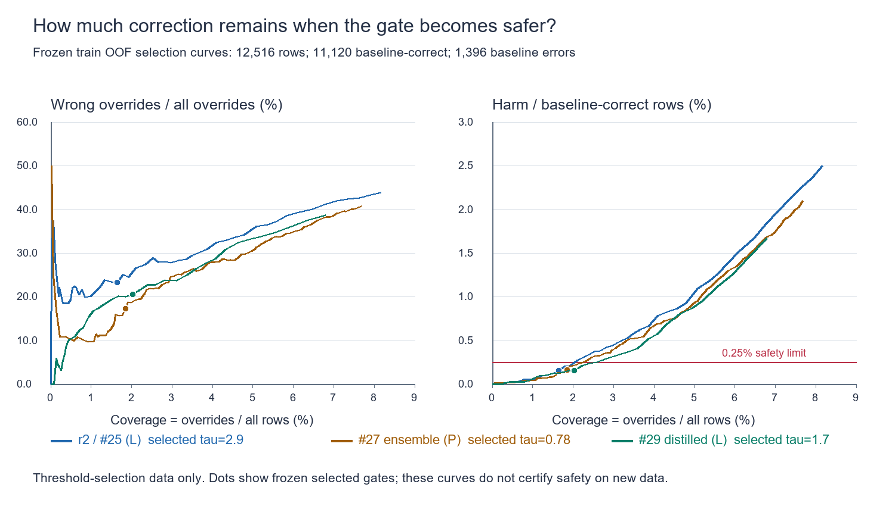

# Sakura Rerank 精度頭打ちの再評価と改善計画

2026-11-04 JST。親 [Issue #1](https://github.com/tsuyoshi-otake/sakura-rerank/issues/1)。**分析と計画は完了。実装、ラベル変更、新規学習、独立Gold Testの実行は未着手・承認待ち。**

優先すべきは、Goldの正解定義・品質と、選択に使わない評価系の確立である。現在の短いTier A devでは候補不足が主因ではなく、goldがあるのに選べないケースと、安全のために救済を抑止するケースが支配的。ただしデータ自体が候補内goldで選別されており、この結論を全文変換一般に拡張してはいけない。モデル容量不足を主因とする証拠はまだない。

## 1. 評価対象と証拠の境界

- Sakura Rerank HEAD: `20fcf527a92c5cf64477e580c4e22ddfa1e9c351`。
- 現在のローカルSakura Input HEAD: `d586fae572d32aa76512994dca616dadef2899b1`（作業ツリーclean）。今回その動作の再認証はしていない。
- 評価snapshotのSakura Input HEAD: `8e966dff456e4e7165e025f97c1f73327ff3f550`。辞書SHA-256: `6d34364b5354d3c67efefaf15b50142b1365b21140ec8eee0f77570d828544ad`。現在HEADとの一致を仮定しない。
- v5 frozen train/devは12,516/1,788件。全1,788件を分母にし、Top-6外8件も保持。元final holdout 3,576件はJSON解析前にsplit markerで除外し、今回の予測・診断には使っていない。既存の集計監査結果のみ参照。
- 既存の未コミットのweight-editレポート等は補助資料として区別し、変更・削除していない。データ、モデル、既存report/manifestは不変。

主証拠: [v1](../reports/sakura-rerank-tiny-v1-research-prototype.json)、[#21](../reports/issue-21-retrain-experiment.json)、[#25](../reports/issue-25-confidence-gate.json)、[#27](../reports/issue-27-ensemble-gate.json)、[#29](../reports/issue-29-distill-gate.json)、[v5 Gate A](../reports/issue-15-tier-a-owner-authorized-audit-v5.json)。Issue本文と結果コメントも照合。#22/#26/#28は実験のPR、#23/#24はライセンス変更であり、独立した精度実験として数えない。

今回の[集計JSON](../reports/accuracy-reassessment-20261104.json)には入力hash、全指標、CI、全閾値のPR/Risk-Coverage値を保存。生の読み・表記・文脈・stable IDは含めない。

## 2. Phase 1 候補生成とランキングの切り分け

### 同一snapshotでのOracle Recall

| 変換器の範囲 | train 12,516件 | dev 1,788件 |
|---|---:|---:|
| Top-1 | 11,120 / 88.8463% | 1,586 / 88.7025% |
| Top-5 | 12,435 / 99.3528% | 1,778 / 99.4407% |
| Top-6（モデル入力） | 12,466 / 99.6005% | 1,780 / 99.5526% |
| Top-10 | 12,502 / 99.8881% | 1,787 / 99.9441% |
| Top-32 | 12,516 / 100% | 1,788 / 100% |

Top-10は新しく候補を生成した結果ではなく、同じ凍結Top-32内での存在率。現在のモデルは6候補契約なので、10候補をそのまま入力してよいという意味ではない。

devのTop-6欠落8件は、順位7〜10に7件、11〜32に1件。trainの欠落50件はそれぞれ36件と14件。**現在のdevでTop-6→10拡張により新しく救える上限は7件、+0.3915 percentage points**。既存順位を壊さず全7件を正しく選べる場合の上限であり期待値ではない。

`data/tier_a.py`はTop-32の候補にNFKC一致のgoldが一つあり、gold経路がsystem dictionaryでforward検証されることを採用条件にしている。そのためTop-32=100%は構築条件でもある。v5生成は24,064件中24,058件を採用、5件は候補不足、1件はgoldが一意でないとして棄却。この1件を候補欠落と断定しない。辞書に収録される表記など、さらに上流の選別もある。一般の入力に対する「候補欠落0件」を示してはいない。

### 同じdevでのモデル比較

R=誤→正（救済）、H=正→誤（破壊）、W=誤→別の誤、O=上書き。`O=R+H+W`、`正解=1,586+R−H`。

| モデル・運用 | 正解 / Accuracy | R | H | W | O | baseline差 |
|---|---:|---:|---:|---:|---:|---:|
| 変換器Top-1 | 1,586 / 88.7025% | 0 | 0 | 0 | 0 | — |
| v1 FP32 ゲートなし | 1,640 / 91.7226% | 77 | 23 | 13 | 113 | +3.0201pt |
| r2 FP32 ゲートなし | 1,639 / 91.6667% | 91 | 38 | 24 | 153 | +2.9642pt |
| #29 FP32 ゲートなし | 1,643 / 91.8904% | 87 | 30 | 24 | 141 | +3.1879pt |
| r2 + #25ゲート L>2.9 | 1,612 / 90.1566% | 29 | 3 | 1 | 33 | +1.4541pt |
| #29 + 採用ゲート L>1.7 | 1,622 / 90.7159% | 39 | 3 | 3 | 45 | +2.0134pt |

「修正失敗」を曖昧にしないため、上書き失敗H+Wと、元の誤りを救えなかったE−R（E=202）を別に記録する。#29ゲートありでは、上書き失敗6件（破壊3、誤→誤3）、元の誤りの未修正163件。

v1は凍結ONNXをCPUで再採点し、R/H/正解が既存reportと一致。r2/#29は保存logitを再計算し、既存reportの全4カウントと一致した。新規学習はしていない。v1のepochはdevで選ばれているため、同じdev上の勝敗は確証と扱わない。

### 最終エラーの排他的な分解

| 原因区分 | v1ゲートなし | r2ゲートなし | #29ゲートなし | #29ゲートあり |
|---|---:|---:|---:|---:|
| 正解がTop-6にない | 8 | 8 | 8 | 8 |
| 元1位が誤り、正解は候補内、モデルが救えない | 117 | 103 | 107 | 107 |
| モデルは救えるがゲートが抑止 | 0 | 0 | 0 | 48 |
| 元1位は正解だが上書きで破壊 | 23 | 38 | 30 | 3 |
| 合計 | 148 | 149 | 145 | 166 |

正解候補が存在するのに最終ランキングが誤りの件数はv1=140、r2=141、#29ゲートなし=137、#29ゲートあり=158。#29のモデル未救済107件は、誤った元1位を保持89件と、候補内の別の誤りを選択18件。gateは救済87→39（48件抑止）、破壊30→3（27件防止）、誤→誤24→3（21件抑止）。

これは**凍結ラベルに対する機械的分類**であり、107件すべてが意味的に解決可能なモデル誤りとは限らない。各エラーと人手ラベル分類の全件クロス表は未作成。ラベルノイズ率をこれらの件数から機械的に差し引かない。

### ラベル品質と分布

「約94.8%」はv4の3,304/3,487=94.7519%。現行v5は3,402/3,576=95.1342%、Wilson 95%下限94.3793%。人手監査ではなくowner-authorized AI teacher監査であり、human Gate AとAI Gate Aはともにfalse。

| v5監査判定 | 件数 / 3,576 | 割合 |
|---|---:|---:|
| valid | 3,402 | 95.1342% |
| ambiguous | 166 | 4.6421% |
| extraction noise | 6 | 0.1678% |
| wrong segmentation | 2 | 0.0559% |
| wrong reading / wrong gold surface | 0 / 0 | 0% / 0% |

明示的な非曖昧の不備は8件（0.2237%）だが、これを人手で確定した真の誤ラベル率とは呼ばない。非valid174件の95.40%が曖昧。v5の「純粋な表記揺れ」単独率は保存集計から確定できない。参考の[v4曖昧性分析](../reports/issue-15-context-bound-ablation-v4.json)は119件を文脈依存56、表記/notation59、同じ意図の許容代替2、分割/構文2に分類。v4の59件をv5へ外挿しない。

v5の採用前21,425件には、2回AI判定に基づくintrinsic ambiguity2,569（11.99%）、repairable error850（3.97%）、noise126（0.59%）があり、17,880件だけがunanimous-validとして残った。それでも第三監査で166件の曖昧性が残る。**AI同士の一致と、制限された入力から唯一の正解を決められることは別**。既存の選択的14件監査でも4件が曖昧だったが、エラー寄りの標本なので母集団率には使わない。

devは読み9文字以下1,764件（98.66%）、gold単一segment1,758件（98.32%）。trainも98.42%/98.09%。長文・複数文節の一般性能を代表しない。devの左文脈なし42件（2.35%）、64文字ちょうど609件（34.06%）。入力は既に左文脈を使い、32文字超の読み/64文字超の保存文脈は0。保存データに超過がないことは、上流抽出前の長文脈が不要である証明ではない。ただしv4監査でも単純な文脈長拡大で解決見込みの曖昧例は0と報告されている。

### 新たに確認した入力重複

記事ID、段落hash、文hashのtrain/dev交差は0。既存split reportの近似文・テンプレートcluster交差も0（今回はその保存値を参照し、全holdoutを再走査していない）。しかし、**v1の全入力テンソルがtrain/dev間で一致する組が8件**。r2のcost-gap特徴を追加しても8件一致した。文字列（左文脈・読み・候補順序）でも一致するので、文字hash衝突だけでは説明できない。gold競合は0、8件すべてbaseline-correct。

train内には同一文字列入力41群、余剰49行。dev内の重複は0。別記事から同じ限定入力へ投影されるため、provenance単位の分割だけではモデル入力の独立性を保証しない。8/1,788=0.4474%の重複であり、頭打ちの主因とは断定できない。旧評価から8件を除外せず、次のGold版で重複componentを分割前にまとめる。

### 外部母集団では候補生成が再び問題になる

[Issue #17](https://github.com/tsuyoshi-otake/sakura-rerank/issues/17)には、別の固定exporterを使ったMSR-IME全文評価でTop-6=946/5,168、Top-32=1,226/5,168、空候補2,624件、128文字契約外832件が記録されている。固定1,000誤りcohortの839件はTop-32外。AJIMEEはTop-6=130/200、Top-32=146/200。これは今回再実行した数値ではなく、**変換器・母集団・分母が違う既存Issueの証拠**。現行短語devと混ぜずに、独立Goldの代表性と候補生成診断を設計する必要性を示す。

## 3. 根本原因として確定したことと未確定のこと

1. **確定: 評価正解の一意性が不十分。** 現行Gate Aは失敗。候補から同じ入力で区別できない表記/意図まで単一正解にすると、妥当な変更をharm、妥当な保持をmissと数える可能性がある。どのエラーが該当するかはblind人手裁定が必要。「ラベル95.13%だから性能上限95.13%」とは言えない。
2. **確定: 安全性とのトレードオフ。** #29の残り166誤りのうち候補欠落は8。ゲート抑止48とモデル未救済107が主要な診断対象。ゲートを外すだけでは破壊30件/1,586=1.8916%となり基準違反。
3. **確定: 評価選択と母集団の限界。** v1のdev epoch選択、反復dev参照、#21のC2選択、#25/#29の非完全nested OOF、8入力重複がある。単語寄り・oracle選別済みデータの勝敗を本番や独立評価と同一視できない。
4. **未確定: 容量/表現/損失のどれが残るモデル誤りを支配するか。** v1→#29はdevで+3件、paired discordance32勝29敗、exact McNemar p=0.798。r2→#29は+4件、20勝16敗、p=0.618。差が小さいことは容量上限の証明ではない。r2 gated→#29 gatedは15勝5敗、未補正p=0.0414だが反復探索なので確認的有意差としない。

#21のC1（絶対cost-gap単独）は全seedで有意差なし、C2（さらにdropout/smoothing）はOOF平均正解+52.7、harm−63.0対B0。cost-gapの情報欠落は実在していたが、C2の複合変更を単独特徴の因果効果と断定しない。#29の蒸留はOOF ungatedのharmを278/261/258→185/188/164へ減らしており、改善が皆無ではない。[#29結果](https://github.com/tsuyoshi-otake/sakura-rerank/issues/29#issuecomment-6617619343)

## 4. Phase 2 Goldとデータ品質の改善計画

まず[子Issue #31](https://github.com/tsuyoshi-otake/sakura-rerank/issues/31)で、bounded inputからの一意正解、複数許容表記、文脈不足、読み/分割/表記誤り、抽出ノイズの定義を凍結する。source-exactはprovenanceの条件であり、意味的な唯一正解の十分条件としない。NFKC一致だけで漢字/仮名/固有名詞の異表記を全面的に同値扱いしない。

自動検出は、forward verification不一致、UTF-8 byte segment再構築、同じ入力の競合gold、重複、異常抽出境界、許容表記候補、モデル間不一致を**レビュー優先順位付け**に使う。自動判定だけで修正しない。確率標本の品質監査と、エラーを集めた診断標本を分け、後者の率を母集団率と呼ばない。

モデル名・予測・splitを伏せた2名の人手判定と不一致裁定を行う。修正は元JSONLへ書き戻さず、旧/新ラベル・理由・方針版・証拠hash・reviewer kindを持つappend-only overlayを作り、新版manifestへ結びつける。raw textや識別子はローカルの非追跡成果物だけに置く。AI提案とhuman verdictを分離する。

主評価の一意正解契約と既存Gate Aの99.5%/Wilson下限99.0%は維持。複数正解集合、曖昧例での保持率/危険上書きは副評価として提案する。定義変更は承認対象であり、この分析では適用していない。曖昧例を除外する場合も元母集団への採用率・除外率を併記し、改善を水増ししない。

[子Issue #32](https://github.com/tsuyoshi-otake/sakura-rerank/issues/32)で、記事/段落/近似文/テンプレートに加えてbounded-input重複のconnected componentを分割前に固定する。過去の学習・dev・監査・手動編集で観察済みのcomponentを新Goldから隔離する。学習量を増やす前に、独立test/calibrationを確保し、train修正へtestの内容や判定を流さない。

## 5. Phase 3 改善案の比較と優先順位

| 優先 | 仮説と比較 | 期待効果の根拠 / 限界 | 検証費用の計画枠 |
|---|---|---|---|
| P0 | Gold方針、blind監査、入力重複・分布修正 | 測定の信頼性を回復。Accuracy増分は未推定 | 仕様/監査基盤2–4人日＋初期1,000件二重確認17–34 reviewer-hours＋裁定。分布/重複監査1–2人日 |
| P1 | confidence × absolute local-cost-gap、独立calibration | #29が抑止する48救済が診断対象。全救済でも最大+2.6857ptであり予測値ではない | 実装検証2–3人日、保存score計算は秒〜分。calibrationのラベル費は別 |
| P2 | 同じ#29でラベル品質・件数の分離比較 | clean/旧labelを同一件数で比較後、25/50/100%のgrouped learning curve。単なる増量はノイズも増やす | 各recipe1–3人日、3seed×5foldでGPU25–60分を計画枠（既存#29規模からの概算） |
| P2 | 特徴・左文脈・候補相対lossを一つずつablation | cost-gapはr2に既存。追加はgap形状・候補差分。true/empty/shuffled左文脈で寄与を測る。現行は既にlistwise CEなのでpairwise/harm-aware差分を比較 | 診断0.5–1人日、各recipe1–3人日＋上記GPU枠 |
| P3 | 同予算の構造変更 / Top-K拡張 | Gold後にも残る誤りに理由がある場合のみ。Top-10の現dev新規oracle上限7件 | 構造比較3–5人日＋15fits/案＋Windows CPU測定。全文候補生成の変更は別責任・別計画 |

見積は承認判断用であり実測ではない。GPU枠はデータ量・構造・完全nested化で増える。各実験は「仮説、唯一の変更、固定入力/hash/seed、選択規則、指標、結果、失敗、CI、採否、計算資源」を独立manifest/reportで保存し、不採用も残す。[子Issue #33](https://github.com/tsuyoshi-otake/sakura-rerank/issues/33)

文脈は同一active sessionでSakura Inputが確定した左側だけ。host文書・右/未来文脈は使わず、focus/session/deactivation境界でclearする。現在入力に左文脈を「新しく足す」だけの案は採らず、現在の使い方と許可された情報で識別可能かを検証する。プロトコルv2、本番既定値、installer/settingsの設計変更は本計画に含めない。

## 6. Phase 4 安全性ゲートとRisk-Coverage



左は`(H+W)/O`という上書き自体の失敗率、右は安全性基準の`H/B`（B=baseline正解）。横軸coverageは`O/N`。この二つのriskは混同しない。全棄却でO=0のprecision/selective riskは未定義であり0%とはしない。図の点は各実験の凍結採用閾値。**train OOFの閾値選択に使ったデータの記述曲線**なので、閾値選択後の独立保証ではない。

| OOF選択時の凍結gate | O / coverage | R / recall (E=1,396) | H / B=11,120 | Precision R/O |
|---|---:|---:|---:|---:|
| #25 L>2.9 | 206 / 1.646% | 158 / 11.32% | 17 / 0.1529% | 76.70% |
| #27 P>0.78 | 231 / 1.846% | 191 / 13.68% | 18 / 0.1619% | 82.68% |
| #29 L>1.7 | 254 / 2.029% | 202 / 14.47% | 17 / 0.1529% | 79.53% |

crossfitは別の集計。#25はRER9.81%のseedがあり不採用。#27はcrossfit救済200/破壊15で精度条件を通るがp95=2.211msで不採用。#29は救済202/213/190、破壊21/19/21、p95=0.661msで研究採用。ただしcrossfitの破壊率95%CI上限は0.289/0.267/0.289%で、0.25%以下の信頼上限条件を満たしていない。

dev #29の破壊3/1,586=0.1892%、両側Clopper–Pearson 95%CI **0.0390–0.5518%**、片側95%上限**0.4881%**。0.25%は維持する。既存の点推定による研究採否と、95%で安全性を示す追加条件は区別し、過去の採用判定を書き換えない。

承認後はfinal model固定後の独立calibrationで、限られたL/P/2変数gateを選ぶ。必要ならcalibrationも選択用/認証用に分けるか、事前登録した多重性対応を用いる。最終testは一度だけ。非完全nested OOFの依存を解消し、pointwise CIを多数閾値から選んだ後の保証として流用しない。[子Issue #34](https://github.com/tsuyoshi-otake/sakura-rerank/issues/34)

## 7. Phase 5 独立評価の設計と現在言える範囲

**独立Gold Testの比較結果はまだ存在しない。** 以下は同じ旧devの記述的再評価で、選択バイアスを除去した数値ではない。

| 指標 | v1 ungated | r2 ungated | #29 ungated | #29 gated |
|---|---:|---:|---:|---:|
| Accuracy 95%CI | 90.35–92.91% | 90.29–92.86% | 90.53–93.07% | 89.28–91.98% |
| 修正成功R | 77 | 91 | 87 | 39 |
| 上書き失敗H+W | 36 | 62 | 54 | 6 |
| 正解破壊H | 23 | 38 | 30 | 3 |
| 元の誤りへの適用率 (R+W)/202 | 44.55% | 56.93% | 54.95% | 20.79% |
| 全件への適用率 O/1,788 | 6.32% | 8.56% | 7.89% | 2.52% |
| Precision R/O | 68.14% | 59.48% | 61.70% | 86.67% |
| Precision 95%CI | 59.08–76.01% | 51.56–66.93% | 53.47–69.31% | 73.82–93.74% |
| Recall R/202 | 38.12% | 45.05% | 43.07% | 19.31% |
| Recall 95%CI | 31.70–44.98% | 38.34–51.94% | 36.43–49.96% | 14.46–25.30% |
| 破壊率H/1,586の95%CI | 0.921–2.168% | 1.701–3.274% | 1.280–2.689% | 0.039–0.552% |
| baselineとの差 | +3.020pt | +2.964pt | +3.188pt | +2.013pt |
| paired差の近似95%CI | +1.933–4.107pt | +1.727–4.202pt | +2.011–4.364pt | +1.309–2.718pt |

Accuracy/Precision/RecallはWilson、破壊率はexact binomial、paired差は行ごとの−1/0/+1を使う正規近似。いずれも既存ラベルと行独立の近似に条件付きで、ラベル誤り・選択バイアス・cluster相関をCI幅だけで補正してはいない。Gold Testでは記事/入力component単位bootstrapとpaired検定、多重性補正を事前登録する。

オフライン保存scoreとv1採点では全行を処理し失敗0。オンラインのtimeout/stale/worker unavailableはこの比較で測定していない。今後もfallbackとして元順位を返し、全件分母から消さず、別の実行状態列に記録する。推論のみp95とworker roundtrip/memoryを混同しない。v1の旧3ms台は毎回NPZ読み込みを含む計測であり、[同範囲再測定](../reports/issue-21-v1-latency-same-scope.json)の約0.665ms p95と比較する。

### 新Gold Testの凍結手順

1. 過去に未使用のsource componentsを確保し、代表母集団と難例challengeを分離。候補内goldだけを抽出しない。短語/全文、語長、文脈、固有名詞/同音異義/表記揺れ、候補欠落・空候補・unsupportedを保存する。研究入力契約外の例は明示的なlocal fallbackとして別層で数える。
2. train・calibration・testをprovenanceと入力重複で分離し、先に版/hashを固定。Gold判定者へモデルの勝敗を見せない。旧holdoutを都合よく修正して新しい独立testと呼ばない。
3. v1/r2/#29の重み・精度形式・同一候補snapshotを固定。ungated同士と各々calibrationで凍結したgate付き同士を分ける。v1の新gateはtestで選ばない。過去の採用gateも歴史的対照として残す。
4. 一度のtest評価で上表の指標と全失敗、paired差、CI、Gate A/B/C、未見辞書追加への回帰を報告。Gate A未達なら本番評価合格としない。結果を見てtest label、gate、モデルを調整したら、その版は以降探索用とし、新testを用意する。

### 安全性のサンプル数と費用

片側95%上限0.25%以下に必要なbaseline正解数は、破壊0なら1,197、1なら1,896、3なら3,100、5なら4,203。これは固定標本での計画補助であり、「通るまで追加する」停止規則ではない。

候補案は代表test約12,000件（baseline正解約10,000件を見込む）と独立calibration約3,000件。baseline正解n=10,000の固定検定で許容破壊数16。真の破壊率0.10%なら検出力97.3%、0.15%なら66.4%なので、0.25%付近のモデルはこの規模でも容易には証明できない。実際の母集団と記事相関をpilotで確認して、testを開ける前に標本数を決める。

15,000件を2名で1判断30–60秒とすると250–500 reviewer-hours＋裁定。評価実装3–5人日。これは承認前の費用枠であり、まず1,000件pilotで判定時間・一致率・ambiguity率・代表性を測って確定する。[子Issue #35](https://github.com/tsuyoshi-otake/sakura-rerank/issues/35)

## 8. 承認対象の子Issueと進め方

| 順序 | 子Issue（すべて#1にGitHub sub-issueとして登録） | 実行条件 |
|---|---|---|
| 1 | [#31 Gold方針・品質](https://github.com/tsuyoshi-otake/sakura-rerank/issues/31) | 初期pilotとラベル方針の承認 |
| 1 | [#32 候補上限・重複・分布](https://github.com/tsuyoshi-otake/sakura-rerank/issues/32) | 読み取り監査/新版split設計の承認 |
| 2 | [#35 独立Gold評価](https://github.com/tsuyoshi-otake/sakura-rerank/issues/35) | #31/#32の契約を使い、まず評価設計とtest隔離、最終実行は最後 |
| 3 | [#34 安全性ゲート](https://github.com/tsuyoshi-otake/sakura-rerank/issues/34) | 独立calibration確保と選択規則の事前登録 |
| 4 | [#33 モデルablation](https://github.com/tsuyoshi-otake/sakura-rerank/issues/33) | Gold品質と測定系を確保。根拠のある仮説だけ再学習 |

## 9. 今回の検証とIRV

| Verify（実施済み） | Expect / 結果 |
|---|---|
| 凍結source/cache/predictions/student logitsのSHA-256照合 | manifest/reportと一致。train/dev全14,304行のgold・Top-6 prefix対応一致 |
| v1凍結FP32のCPU batch1採点＋r2/#29保存score再集計 | 既存reportの正解/R/H/Oに一致。再学習なし |
| 再集計を再実行しaggregate JSONのSHA-256を比較 | byte一致。元データ・モデル不変 |
| `PYTHONPATH=src python -m unittest discover -s tests -p test_generated_reports.py` | 20件成功、120秒の親timeout内で終了 |
| `git diff --check`、追加成果物のraw-text/ID検査、process audit | 空白エラーなし。集計のみ。今回のPython/ORT/test残存0 |

実施しなかった検証は、新Goldの人手監査、Gold Test、本番HEADへの一般化、online failure/latencyの再計測。これらを未達のまま合格扱いしない。学習・本番コードに変更がないため、全学習の再実行や本番integration regressionは今回の範囲外。

process auditで名前検索に一致した既存のinstalled Sakura Input workerは、今回の作業前（11月3日）から稼働するユーザー環境のprocessであり、task-ownedではないため停止していない。今回起動した採点・集計・test processの残存は0。一時script/数値score/図の作業copyはtask専用tmpから削除し、再現コードは本書付録に保持する。

**A 実際の理解範囲:** Issue #1/#15/#17/#21〜#29、関連report/manifest、v1入力・順位指標、Tier Aのgold採用契約、実験README、保存train/dev予測、既存generated-reportテスト。元コーパス本文は診断出力に出さない。

**B 範囲拡張:** Top-5/10と重複確認には数値cacheだけでは足りず、凍結Top-32付きsplitをtrain/dev限定で読む必要があった。候補Recallの一般化を確認するためTier A採用条件と#17を追加。多実験の横断比較なので通常の局所Issueのguide予算を超えるが、モデル内部全体や本番実装への探索は拡張していない。

**C Architecture:** 振る舞い・state owner・public API・依存関係の変更なし。候補はconverter/snapshot、goldはdataset版、scoreはmodel、適用判断はgateが所有する境界を保持。新規作成は分析成果物と計画Issueだけ。

**D 将来IRV:** 次の作業はこの分母・error分解・根拠リンク・子Issueから開始でき、#21〜#29全コメントの再探索を省ける。新たに理解すべき契約はGoldの一意/同値/曖昧分類、入力単位の独立性、threshold選択と認証の分離。今回は境界の実装改善はしていない。

## 10. 再計算用コード

以下は今回実行した読取り分析の再現用コード。学習/データ変更の実装ではない。各ブロックをtask専用の`~/tmp/`ディレクトリに記載名で保存し、repo rootをcwdとして実行する。既存成果物は読むだけ。`v1_scores.py`はPython3.13.13 / NumPy2.3.5 / ONNX Runtime1.23.2の既存環境で実行。`analyze.py`はPython3.13.13 / NumPy2.5.2とSciPy、図はPillowの既存環境を使用。新規依存の導入なし。環境構築が必要な場合はtask-specific venvと年齢/lock規約に従う。

`v1_scores.py` → `analyze.py` → `plot.py`の順で実行。生成される一時score配列は集計後削除する。図の再現にはWindows Arialが必要。CPU採点は速度benchmarkではない。

再計算環境補記: SciPy 1.18.0、Pillow 12.3.0。

<details><summary>v1_scores.py</summary>

```python
import os
os.environ['CUDA_VISIBLE_DEVICES'] = ''
for key in ('OMP_NUM_THREADS','MKL_NUM_THREADS','OPENBLAS_NUM_THREADS'):
    os.environ[key] = '1'
from pathlib import Path
import hashlib
import numpy as np
import onnxruntime as ort
root = Path.cwd()
base = root/'data/generated/sakura-rerank-tiny-v1-research'
model = base/'sakura-rerank-tiny-v1-fp32.onnx'
assert hashlib.sha256(model.read_bytes()).hexdigest() == 'b3fe1e0aa7229edfd0760162d648f10328b0d75224a9cd49f2ba986b7db2ccbd'
opts = ort.SessionOptions()
opts.intra_op_num_threads = opts.inter_op_num_threads = 1
opts.execution_mode = ort.ExecutionMode.ORT_SEQUENTIAL
session = ort.InferenceSession(str(model), sess_options=opts, providers=['CPUExecutionProvider'])
with np.load(base/'train-dev-cache.npz', allow_pickle=False) as archive:
    arrays = {x.name: archive['dev_'+x.name] for x in session.get_inputs()}
scores = np.concatenate([session.run(None,{k:v[i:i+1] for k,v in arrays.items()})[0] for i in range(1788)])
np.save(Path(__file__).parent/'v1-dev-scores.npy', scores, allow_pickle=False)
print('v1 frozen FP32 dev scoring complete: 1788 rows, CPU only, batch one; no training')
```

</details>

<details><summary>analyze.py</summary>

```python
from pathlib import Path
import json, hashlib, collections, math, sys
import numpy as np
from scipy.stats import beta, binom, binomtest
ROOT=Path.cwd()
TMP=Path(__file__).parent
def read(p): return json.loads((ROOT/p).read_text(encoding='utf-8'))
def sha(p): return hashlib.file_digest(open(p,'rb'),'sha256').hexdigest()
def cp(k,n): return [float(beta.ppf(.025,k,n-k+1)) if k else 0.,float(beta.ppf(.975,k+1,n-k)) if k<n else 1.]
def wilson(k,n):
 z=1.959963984540054;p=k/n;d=1+z*z/n;c=(p+z*z/(2*n))/d;h=z*math.sqrt(p*(1-p)/n+z*z/(4*n*n))/d
 return [c-h,c+h]
paths=['data/generated/sakura-rerank-tiny-v1-research/train-dev-cache.npz','data/generated/issue-21-retrain/predictions.npz','data/generated/issue-29-distill-gate/final/dev-logits.npz','data/generated/issue15-v5-slot120/frozen-split.jsonl']
hashes={p:sha(ROOT/p) for p in paths}
assert hashes[paths[0]]=='41eb7f59c4912d3216836ed9cb153a3e3b952e8673d5fce3e71a020b24781624'
assert hashes[paths[1]]=='3be6ad904fd669b088ebfe9553bdc1f83c83f3ca29b077480167c30eb7392e52'
assert hashes[paths[3]]=='0651bfaa3fb67da7980dcbbe4ad5de6e383e2878c726ace53a189d74519b1d82'
with np.load(ROOT/paths[0],allow_pickle=False) as a: cache={k:a[k] for k in a.files}
with np.load(ROOT/paths[1],allow_pickle=False) as a: pred={k:a[k] for k in a.files}
with np.load(ROOT/paths[2],allow_pickle=False) as a: student=a['scores'].astype(np.float64)
reports={n:read(f'reports/issue-{n}-'+{25:'confidence',27:'ensemble',29:'distill'}[n]+'-gate.json') for n in [25,27,29]}
assert hashes[paths[2]]==reports[29]['final_student']['dev_logits_sha256']
profiles={s:collections.Counter() for s in ['train','dev']};keys={s:collections.defaultdict(set) for s in profiles};rows={s:[] for s in profiles};seen={s:collections.defaultdict(list) for s in profiles};heldout_skipped=0
with open(ROOT/paths[3],'rb') as f:
 for line in f:
  if b'"split":"final-holdout"' in line or b'"split": "final-holdout"' in line:
   heldout_skipped+=1;continue
  d=json.loads(line);s=d['split'];assert s in profiles
  p=profiles[s];g=d['gold_index'];c=d['candidate_snapshots']['training_top32']['candidates'];c6=d['candidate_snapshots']['production_top6']['candidates'];i=p['n'];assert g>=0 and c[g]['surface']==d['gold_surface']
  assert [x['surface'] for x in c6]==[x['surface'] for x in c[:6]]
  assert cache[s+'_gold'][i]==(g if g<len(c6) else -1)
  p['n']+=1
  for k in [1,5,6,10,32]:p['top'+str(k)]+=g<k
  p['empty_context']+=not d['session']['left_context'];p['context_at64']+=len(d['session']['left_context'])==64;p['reading_le9']+=len(d['reading'])<=9;p['reading_gt32']+=len(d['reading'])>32;p['context_gt64']+=len(d['session']['left_context'])>64;p['gold_segments_1']+=len(c[g]['segments'])==1;p['candidates32']+=len(c)==32
  for k in ['article_id','paragraph_hash','sentence_hash','template_cluster_id']:
   if d['source'][k] is not None:keys[s][k].add(d['source'][k])
  sig=hashlib.sha256(json.dumps([d['session']['left_context'],d['reading'],[x['surface'] for x in c6]],ensure_ascii=False).encode()).hexdigest();seen[s][sig].append(g)
  rows[s].append({'g':g,'empty':not d['session']['left_context'],'short':len(d['reading'])<=9,'gap':c[1]['local_cost']-c[0]['local_cost']})
assert heldout_skipped==3576
assert profiles['train']['n']==12516 and profiles['dev']['n']==1788
gold=cache['dev_gold'];N=len(gold);B=int((gold==0).sum());E=N-B
scores={'v1':np.load(TMP/'v1-dev-scores.npy',allow_pickle=False).astype(np.float64),'r2':pred['dev_C2-s20260814'].astype(np.float64),'29':student}
scores['27']=sum(pred['dev_C2-s'+str(s)].astype(np.float64) for s in [20260814,20261103,20261104])/3
def gate(z,score,tau):
 t=z.argmax(1);v=z if score=='L' else np.exp(z-z.max(1,keepdims=True))/np.exp(z-z.max(1,keepdims=True)).sum(1,keepdims=True)
 return np.where((v[np.arange(N),t]-v[:,0])>tau,t,0)
def metrics(t):
 good=t==gold;base=gold==0;changed=t!=0;r=int((good&~base).sum());h=int((~good&base).sum());o=int(changed.sum());w=o-r-h;unfixed=E-r
 se=math.sqrt(((r+h)/N-((r-h)/N)**2)/N)
 return dict(n=N,correct=int(good.sum()),accuracy=float(good.mean()),accuracy_ci95=wilson(int(good.sum()),N),rescue=r,harm=h,overrides=o,wrong_to_wrong=w,unfixed_baseline_errors=unfixed,correct_candidate_present_but_wrong=int(((gold>=0)&~good).sum()),missing_top6=int((gold<0).sum()),application_rate=o/N,error_target_application_rate=(r+w)/E,precision=r/o if o else None,precision_ci95=wilson(r,o) if o else None,recall=r/E,recall_ci95=wilson(r,E),oracle_rescue_recall=r/int((gold>0).sum()),harm_rate=h/B,harm_ci95=cp(h,B),harm_upper_one_sided95=float(beta.ppf(.95,h+1,B-h)),delta_pp=100*(r-h)/N,paired_delta_normal_ci95_pp=[100*((r-h)/N-1.96*se),100*((r-h)/N+1.96*se)],rer=(r-h)/E)
decisions={'baseline':np.zeros(N,int)}
for k,z in scores.items():decisions[k+'_ungated']=z.argmax(1)
decisions['r2_gated']=gate(scores['r2'],'L',2.9);decisions['29_gated']=gate(scores['29'],'L',1.7);decisions['27_gated']=gate(scores['27'],'P',.78)
metrics_all={k:metrics(t) for k,t in decisions.items()}
for k,n in [('r2',25),('27',27),('29',29)]:
 ref=reports[n]['dev_reference'];ref=ref.get('20260814',ref)
 for g in ['gated','ungated']:
  for m in ['correct','rescue','harm','overrides']:assert metrics_all[k+'_'+g][m]==ref[g][m]
assert metrics_all['v1_ungated']['correct']==1640 and metrics_all['v1_ungated']['harm']==23
gating={}
for k in ['r2','27','29']:
 u=decisions[k+'_ungated'];g=decisions[k+'_gated'];blocked=(u!=0)&(g==0)
 gating[k]={'blocked_rescues':int((blocked&(u==gold)).sum()),'prevented_harms':int((blocked&(gold==0)).sum()),'blocked_wrong_to_wrong':int((blocked&(gold!=0)&(u!=gold)).sum()),'model_failed_with_gold_present':int(((gold>0)&(u!=gold)).sum()),'model_kept_wrong_baseline':int(((gold>0)&(u==0)).sum())}
pairs={}
for a,b in [('v1_ungated','r2_ungated'),('v1_ungated','29_ungated'),('r2_ungated','29_ungated'),('r2_gated','29_gated')]:
 ga=decisions[a]==gold;gb=decisions[b]==gold;gain=int((~ga&gb).sum());loss=int((ga&~gb).sum());pairs[a+'_vs_'+b]={'gain':gain,'loss':loss,'exact_mcnemar_p':float(binomtest(gain,gain+loss).pvalue) if gain+loss else 1.}
leak={k:len(keys['train'][k]&keys['dev'][k]) for k in keys['train']}
dup={s:{'repeated_input_groups':sum(len(v)>1 for v in seen[s].values()),'excess_duplicate_rows':sum(len(v)-1 for v in seen[s].values()),'conflicting_gold_groups':sum(len(set(v))>1 for v in seen[s].values())} for s in seen};dup['cross_split_identical_input_groups']=len(set(seen['train'])&set(seen['dev']))
numeric={}
for s in ['train','dev']:
 numeric[s]=collections.defaultdict(list)
 names=sorted(k for k in cache if k.startswith(s+'_') and not k.endswith('_gold'))
 for i in range(len(cache[s+'_gold'])):
  h=hashlib.sha256()
  for k in names:h.update(cache[k][i].tobytes())
  numeric[s][h.hexdigest()].append(int(cache[s+'_gold'][i]))
overlap=set(numeric['train'])&set(numeric['dev'])
dup['cross_split_identical_v1_numeric_inputs']=len(overlap)
dup['cross_split_numeric_label_conflicts']=sum(len(set(numeric['train'][k]+numeric['dev'][k]))>1 for k in overlap)
dup['dev_duplicate_input_baseline_correct']=sum(numeric['dev'][k].count(0) for k in overlap)
with np.load(ROOT/'data/generated/sakura-rerank-tiny-r2-research/cost-gap.npz',allow_pickle=False) as a: gaps={k:a[k] for k in a.files}
r2keys={}
for s in ['train','dev']:
 r2keys[s]=set()
 for i in range(len(cache[s+'_gold'])):
  h=hashlib.sha256()
  for k in sorted(k for k in cache if k.startswith(s+'_') and not k.endswith('_gold')):h.update(cache[k][i].tobytes())
  h.update(gaps[s+'_cost_gap'][i].tobytes());r2keys[s].add(h.hexdigest())
dup['cross_split_identical_r2_numeric_inputs']=len(r2keys['train']&r2keys['dev'])
curves={}
for n in [25,27,29]:
 sel=reports[n]['final_selection'];sel=sel.get('20260814',sel)
 curves[str(n)]={s:[dict(x,coverage=x['overrides']/12516,selective_risk=(x['overrides']-x['rescue'])/x['overrides'] if x['overrides'] else None,harm_rate=x['harm']/11120,precision=x['rescue']/x['overrides'] if x['overrides'] else None,recall=x['rescue']/1396) for x in c] for s,c in sel['oof_curves'].items()}
audit=read('reports/issue-15-tier-a-owner-authorized-audit-v5.json')
out={'scope':'historical train/dev diagnosis; not independent Gold test or production evidence','rerank_head':'20fcf527a92c5cf64477e580c4e22ddfa1e9c351','observed_input_head':'d586fae572d32aa76512994dca616dadef2899b1','snapshot_input_head':'8e966dff456e4e7165e025f97c1f73327ff3f550','hashes':hashes,'profiles':profiles,'leakage_train_dev':leak,'duplicates':dup,'holdout_rows_skipped_before_json':heldout_skipped,'metrics':metrics_all,'gating':gating,'paired_dev_exploratory':pairs,'risk_coverage_oof_selection_data':curves,'audit_v5_verdicts':audit['verdict_counts'],'sample_size_zero_harms_one_sided95':math.ceil(math.log(.05)/math.log(1-.0025)),'environment':{'python':sys.version.split()[0],'numpy':np.__version__}}
(TMP/'analysis.json').write_text(json.dumps(out,indent=2,ensure_ascii=False,allow_nan=False)+'\n',encoding='utf-8')
print(json.dumps({k:v for k,v in out.items() if k not in ['risk_coverage_oof_selection_data','hashes']},ensure_ascii=True))
```

</details>

<details><summary>plot.py</summary>

```python
from pathlib import Path
import json
from PIL import Image, ImageDraw, ImageFont
p=Path(__file__).parent
d=json.loads((p/'analysis.json').read_text())
im=Image.new('RGB',(1500,850),'white');draw=ImageDraw.Draw(im)
def font(n):return ImageFont.truetype('C:/Windows/Fonts/arial.ttf',n)
def text(x,y,s,n=22,fill='#253045'):draw.text((x,y),s,font=font(n),fill=fill)
text(55,25,'How much correction remains when the gate becomes safer?',32)
text(55,75,'Frozen train OOF selection curves: 12,516 rows; 11,120 baseline-correct; 1,396 baseline errors',21)
series=[('25','L',2.9,'#2269af','r2 / #25 (L)'),('27','P',.78,'#a05d09','#27 ensemble (P)'),('29','L',1.7,'#087e68','#29 distilled (L)')]
for panel,(key,ymax,title) in enumerate([('selective_risk',.6,'Wrong overrides / all overrides (%)'),('harm_rate',.03,'Harm / baseline-correct rows (%)')]):
 x0=85+panel*740;y0=205;w=610;h=440
 text(x0,y0-44,title,25)
 def xy(x,y):return (x0+x/.09*w,y0+h-y/ymax*h)
 for k in range(7):
  y=ymax*k/6;_,yy=xy(0,y);draw.line((x0,yy,x0+w,yy),fill='#d9e0e7',width=1);text(x0-57,yy-11,f'{100*y:.1f}',18)
 for k in range(10):
  xx,_=xy(k/100,0);draw.line((xx,y0+h,xx,y0+h+6),fill='#617082',width=1);text(xx-6,y0+h+12,str(k),18)
 draw.line((x0,y0,x0,y0+h,x0+w,y0+h),fill='#617082',width=2)
 text(x0+100,y0+h+48,'Coverage = overrides / all rows (%)',22)
 if key=='harm_rate':
  _,yy=xy(0,.0025);draw.line((x0,yy,x0+w,yy),fill='#ba3047',width=2);text(x0+385,yy-26,'0.25% safety limit',18,'#ba3047')
 for issue,score,tau,color,label in series:
  curve=d['risk_coverage_oof_selection_data'][issue][score];pts=[xy(x['coverage'],x[key]) for x in sorted(curve,key=lambda x:x['coverage']) if x[key] is not None]
  draw.line(pts,fill=color,width=3)
  s=next(x for x in curve if x['tau']==tau);xx,yy=xy(s['coverage'],s[key]);draw.ellipse((xx-6,yy-6,xx+6,yy+6),fill=color,outline='white',width=2)
for i,(_,_,tau,color,label) in enumerate(series):
 x=85+i*470;draw.line((x,740,x+35,740),fill=color,width=4);text(x+46,726,label+f'  selected tau={tau}',22,color)
text(55,790,'Threshold-selection data only. Dots show frozen selected gates; these curves do not certify safety on new data.',21)
im.save(p/'risk-coverage.png')
```

</details>
