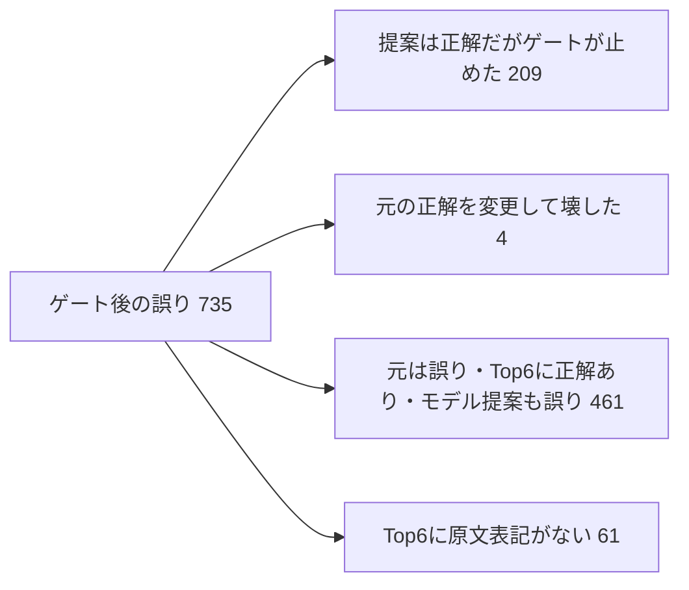

# 精度改善を入力課題・文脈学習・適用判断から見直す (#33)

2026-11-05。親 #1、関連 #15/#31/#32/#34/#35。**今回の結論は、文脈で区別する学習課題を作り、その文脈を候補評価へ直接つなぐことを最優先にする。Wikipediaの追加取得だけを次の実験にしない。**

検討に加え、既存10モデルについて60通りの文脈診断を実行した。新しい学習・モデル採用・閾値選択は0。使用したのは既に結果を見た研究用4,000件で、原文一致を仮の正解とする。独立Gold、最終Test、実IME全体の精度ではなく、旧devの90.72%とも直接比較しない。

## 1. 新たに測定できたこと

### 文脈を大きく変えても順位がほとんど変わらない

読み、候補、特徴量、重みを固定し、文脈だけを空、直前8文字、同じ出典種別・長さ区分内の別文脈に変更した。シャッフルは3個の固定seed、自己割当なし。全10モデルの元の推論を先に再現し、保存logitとの最大差は**0.0**、ゲートあり/なしの予測も完全一致した。

以下はゲートなしの正解数 / 4,000。範囲は3シャッフルの最小–最大であり信頼区間ではない。各行の学習seedは既存実験から引き継ぎ、診断結果でモデルを選ばない。

| モデル | 元文脈 | 文脈なし | 直前8文字 | シャッフル3通り | 8文字化で1位が変わる件数 |
| --- | ---: | ---: | ---: | ---: | ---: |
| 現行 #29 | 3,277 | 3,274 | 3,277 | 3,273–3,277 | 1 |
| Wiki小 / 20260814 | 3,326 | 3,322 | 3,326 | 3,322–3,328 | 0 |
| Wiki小 / 20261103 | 3,319 | 3,319 | 3,319 | 3,318–3,320 | 1 |
| Wiki小 / 20261104 | 3,324 | 3,323 | 3,323 | 3,320–3,324 | 1 |
| Wiki大 / 20260814 | 3,315 | 3,315 | 3,316 | 3,315–3,317 | 1 |
| Wiki大 / 20261103 | 3,326 | 3,319 | 3,326 | 3,321–3,325 | 0 |
| Wiki大 / 20261104 | 3,314 | 3,314 | 3,314 | 3,311–3,314 | 0 |
| 混合 / 20260814 | 3,383 | 3,392 | 3,384 | 3,383–3,387 | 1 |
| 混合 / 20261103 | 3,381 | 3,378 | 3,381 | 3,377–3,380 | 0 |
| 混合 / 20261104 | 3,384 | 3,374 | 3,384 | 3,375–3,384 | 0 |

混合3本は文脈なしの差が−0.250〜+0.225ポイント。シャッフルで変わる1位は11〜28件、全体の0.275〜0.700%。**この集団上で、現在の順位判断の文脈依存性が弱いことは実測できた。** 文脈なしを採用する根拠ではなく、別アーキテクチャの優位性の証明でもない。介入は分布外になり得るし、現在の集団自体が文脈識別を十分要求していない可能性がある。

現行C2は、文脈・読み・各候補を共有GRUで**独立に**128次元へ圧縮し、最後に結合してMLPへ渡す。候補を読む途中で文脈状態を参照する構造ではない。一方、MLPの非線形性による相互作用は可能であり、「文脈を使えない実装」とは断定しない。損失は既にlabel smoothing付きlistwise cross entropy。単なるlistwise化は新案にならない。

### ゲートだけを改善する場合の限界

混合 / 20260814 のゲート後は3,265正解、735誤り。その735件は次の重複しない内訳になる。

現在の1位提案を「採用する / 元へ戻す」だけで完全に選別できる仮想上限は、元々正しい3,174 + 提案による救済304 = **3,478 / 4,000 = 86.95%**。現状81.625%との差は213件、5.325ポイント。ただし正解ラベルを先に知る非実装的な上限で、期待改善幅ではない。他の混合seedの上限も86.80%、87.10%。上限を超えるには、別の候補を正しく提案できる必要がある。

10モデルのどれかの1位、または変換器1位を、正解を知って選ぶ上限も**3,523 / 4,000 = 88.075%**。元の誤変換でTop6に原文表記があるが、10モデル全てが救えないものが**416件**ある。単なるモデル選択ではここを救えない。logit平均が各モデルの1位以外を選ぶ可能性はあるので、この数値をあらゆるensembleの上限とは呼ばない。

Top6からTop10で追加される正解候補は39件（0.975ポイント相当）、Top32までは61件（1.525ポイント相当）。候補存在率の増分上限であり、順位学習で実現する改善ではない。今回の優先順位では、461件のランキング失敗への対処が先になる。Gates A/B前のproduction protocol v2設計・実装には進まない。

### 単純な閾値変更と文字語彙修正を先行させない理由

混合 / 20260814 の既存margin `0 < L <= 1.7` には、救済209件、破壊91件、誤りから別の誤りへの変更87件が混在する。事前に固定した `(1, 1.7]` 区間だけでも救済83件と破壊16件がある。単なる緩和では両方を受け入れる。全区間・全モデルを[集計JSON](../../reports/issue-33-fundamentals-v1.json)に保持し、最適閾値は探索していない。

文字hashは観測3,402文字を3,153 IDへ写し、247 bucketで496文字が衝突していた。ただし、同じ入力内の異なる候補表記が完全に同じtoken列になる例は0、候補32文字切捨ても0。衝突が意味学習を損ねる可能性は残るが、今回の誤りを直接説明できたわけではない。可逆な文字ID化は後続の単独比較とする。

読みと候補の共通prefix特徴は23,967候補のうち19,111で0、辞書由来flagは23,931で1だった。特徴の情報量が限られるという診断であり、削除による改善を証明しない。

## 2. 根本仮説: 現在の学習課題が実際の変換判断を十分に教えていない

**確定した観測**と**残る仮説**を分ける。

- 新4,000件でも読み10文字以上は21件だけ。旧trainも98.09%が正解1 segment。辞書の一意読み・短い表記を採る仕組みは、文章源を増やしても課題の偏りを残す。
- 4,000件に2,907種類の読みがあり、同じ読みに異なる原文表記が付くのは85組・271件。読みごとの多数表記を正解を見て選ぶ経験的上限は97.5%。これは学習可能な精度や母集団上限ではないが、現在の評価で文脈識別が必須と観測できる例が限られることを示す。
- 完全な左文脈＋読みが同一でラベルが衝突する例は0。しかし全4,000入力が異なるため、「曖昧性なし」とは言えない。辞書上の読みの一意性、作者が選んだ表記、利用者にとっての正解は別の性質のまま。
- 全4,000件の文脈由来は `synthetic_source_prefix_not_observed_session`。現実には同セッションのSakura確定文だけを使え、フォーカス変更等で消える。原文の前64文字をいつも利用できるという評価条件は、製品での文脈利用可能率を証明しない。

以上から、モデルが候補表記・読み・変換器costの規則に依存し、文脈で同音異義語を区別する能力を十分獲得していない、という仮説を優先する。**学習例不足、学習目的、独立符号化のどれが支配的かは今回だけでは確定しない。** 同一データ・同一計算予算の対照実験で切り分ける。

## 3. 改善案と実施順序

費用は実装・検証作業量の計画値であり実測ではない。今回の9適応学習は合計152秒、60診断は21.438秒だったが、新しい構造や言語事前学習へこの速度を外挿しない。以下は**次期計画で、まだ実装・学習していない**。

| 順序 / 所有Issue | 変更案・検証する仮説 | 期待効果の位置づけ | 最小の検証と費用 |
| --- | --- | --- | --- |
| 1 / #31・#32・#33 | **入力単位と文脈識別の研究用pilot**。外部の読み注釈を維持し、辞書見出し1個だけでなく短句・活用・複合語を含める。同じ読み/候補でも前文脈で目標が異なる組を別掲 | 今のデータで見えない失敗を測る。改善率は未確定。まず誤った課題を大量生産するのを防ぐ | 最大1,000対象、出典単位で先に隔離。候補欠落・読みに問題・曖昧例も母数から除かず状態別集計。目安2–3作業日、学習0 |
| 2 / #33 | **文脈を候補評価へ直接つなぐ小型モデル**。左文脈のGRU状態から各候補の符号化を続け、局所costへの残差を出す | 現行10モデルが救えない416件の領域が主対象。ただし416件は回収見込みではない | 現行独立GRU vs 文脈条件付きGRU、データ・損失・3 seeds・更新数固定。目安1–2作業日、6 fits。CPU測定を別途実施 |
| 3 / #33 | **本文を言語事前学習に使う**。上記の同じ小型構造を、左文脈から続きを予測する課題で先に学習してから順位学習 | Wikipedia増強を、弱い正解ラベルの量産ではなく言語知識の獲得に使う。未救済候補の文脈適合を学ぶ仮説 | 同じ構造の事前学習あり/なしを比較。まず隔離済み最大100万window・最大GPU4時間を計画上限に事前固定。目安2–4作業日。超過時は未完了を残す |
| 4 / #34 | **候補選択と適用判断を別の目的で学ぶ**。選んだ候補とbaselineの差から救済/破壊/誤→誤を識別。raw marginだけに頼らない | 現行単一モデルでゲートが止めた197–213救済と残存破壊が対象。仮想上限は改善予測ではない | rankingのOOF提案から適用器を学習し、独立calibrationで閾値固定。既存marginと同じriskで比較。目安2–3作業日＋calibration確保 |
| 5 / #33 | **別の言語知識を持つ教師で蒸留**。かな漢字変換用の既存言語モデルをoffline候補scorerとしてまず検査 | 同じC2群による既存#29蒸留と異なる知識を導入できるか。優位性を測る前に学生へ移さない | ライセンス・学習出典・評価混入確認後、固定候補だけを採点する小規模probe。目安2–4作業日。教師が改善しなければ蒸留しない |

### 最初のpilotを人員待ちにしない

外部で人手修正された注釈を読みの根拠として利用する道はある。既存の[KWDLC 50文書probe](../../reports/issue-31-kwdlc-probe-v1.md)では、Sakura辞書で一意ではない17件の読みも得られた。ただし morphology の境界はIME確定境界と同じではないので、形態素、基本句、短い連続単位を**別の入力方針として**固定し、一律に単語境界へ強制しない。converterの実候補で全読み経路を照合し、欠落も測る。

KWDLCは人手修正形態素注釈と複数ジャンルを提供する一方、提供者READMEには原文権利者の個別許諾未取得・元URL非提供が明記される。既存probeの調査範囲を超えた学習・再配布の適格性は未確認であり、無条件の大量投入先にはしない。[提供者README（固定commit）](https://github.com/ku-nlp/KWDLC/blob/c6ae49d29eca4e1134c6676d682adf5ed6a25f5a/README.md)

実施可能な研究は、外部注釈を根拠にしたsilver、原文再現、曖昧/表記意図未確定を区別して進める。AIは論点抽出と不一致候補の整理に限定し、架空の二重人手判定を作らない。Gold 1,000件pilot、最終holdout valid 3,000件以上、点推定99.5% / Wilson下限99.0%の品質目標は別で、今回の自動診断では通過しない。

### 文脈条件付き学習を具体化する

提案する最小構造は `h = encode(left_context)`、`z_j = encode(candidate_j, initial_state=h)` として、`z_j`、読み表現、既存特徴を採点する研究用変更。文脈状態は一度計算し6候補で共有する。読みで許される候補集合は実converterから受け取り、自由生成を製品経路に加えない。現行独立符号化の対照を残して、構造変更と事前学習を別実験にする。

文章の言語事前学習にはIME正解ラベルは不要。ただし誤った読みや意図の認証にはならない。評価に使った記事・作品・入力と近似文章の隔離を、**ラベル付き学習だけでなく事前学習にも**適用する。利用できる左文脈を再現し、文頭/セッション切替、文脈なし/短文脈も別に評価する。今回の文脈8文字以上という制限を実使用全体へ持ち込まない。

この方向には既存のかな漢字変換システムの実装例もある。Zenzaiは読みと左文脈を入力するモデル形式を公開している。ただし他製品の精度がそのままSakuraに移るわけではない。[公式仕様](https://github.com/azooKey/AzooKeyKanaKanjiConverter/blob/main/Docs/zenzai.md)
公開 `zenz-v3.1-small` は90.5M parameters、CC-BY-SA-4.0表示で、今回参照したmodel card本文は空だった。学習出典の完全性や評価混入を確認できていないため、当面は教師候補の調査対象。小型CPUモデルと同じ費用ではなく、製品置換は提案していない。[公開モデル情報](https://huggingface.co/Miwa-Keita/zenz-v3.1-small)

### 安全性に対応する学習・校正

一様な順位正解を増やす目的と、元々正しい変換を壊さない目的を分ける。hard negativeは実N-best由来に限定し、読みで成立しない簡単な偽候補を増やさない。曖昧/許容表記を確定誤答として強く罰しない。複数許容表記を使う場合は、その表記方針・適用範囲・履歴を先に固定し、評価後の正解集合拡張はしない。

適用器の訓練ではrankingモデルがその行を学習した提案を使わず、出典/component単位のOOF提案から作る。calibrationも別に確保し、選択したモデル・特徴・ラベル方針・閾値を固定してから最後のGold Testへ進む。95%区間と比較数を事前固定する。

選択的予測やLearn-then-Testは、採点とリスク制約を分ける方法の参考になる。ただし通常の「採用例中の誤率」と、本プロジェクトの「**元々正しい例を分母とする破壊率**」は別。論文の保証をそのまま流用せず、0.25%という既存基準、出典依存、ラベル誤りを明示した評価契約が必要。[Selective Classification](https://arxiv.org/abs/1705.08500)、[Learn then Test](https://arxiv.org/abs/2110.01052)

独立Bernoulliの仮定で、破壊0件でも両側Clopper–Pearson 95%上限を0.25%以下にするには元々正しい例が少なくとも1,474件必要（`ceil(log(.025)/log(.9975))`）。これは理想条件の必要標本目安であり、同一出典内の相関やラベル品質を解決しないし、Gold 3,000 valid要件も置き換えない。

## 4. 実験の判断条件

1. **D1: 文脈識別を要求する課題が得られるか。** 対象・出典・入力方針・除外理由・曖昧性を先に固定。最大1,000対象を候補成績を見る前に選択し、不足をAI生成や後出し選び直しで埋めない。Verify: provenance/重複/全読み経路/文脈範囲の検査。Expect: 全対象を状態別に説明し、Gold認証は0のまま。読みを共有する異表記組の採用数もそのまま報告。
2. **M1: 文脈との直接結合で救えるか。** 新しい研究用splitを先に固定し、既存C2と提案構造だけを変えて3 seeds比較。Verify: 同一候補・分母でraw/gated Accuracy、rescue、harm、wrong-to-wrong、適用率、Precision/Recall、paired component 95%区間、true/empty/shuffle差。Expect: 原文だけでなく文脈識別部分で整合した改善。文脈への感度が増すだけでは成功にしない。
3. **M2: 言語事前学習は追加効果を持つか。** M1の構造・順位データを固定し、事前学習の有無だけを比較。新実験ごとに選択済み設定と未使用の評価枠を固定し、同じdevを見ながら繰り返し最良モデルを作らない。事前学習単独で次文字lossが下がっても、修正指標が改善しなければ採用しない。
4. **G1: 安全性を保って救済を増やせるか。** モデル選択から独立したcalibrationと最後の一度だけのTestを使う。Verify: risk-coverage、全失敗を含む母数、破壊率の95%上限。Expect: 0.25%を維持しつつ救済改善。Gate A未達なら結果は研究用のまま。
5. **実装可能性。** 研究上の改善が出た案だけ、既存Windows CPU・GPU無効・batch1・ORT各1 thread・warmup・10,000 runsでp95<=2ms / p99<=5ms、メモリ、失敗とfallbackを確認。製品プロトコル変更、デフォルト有効化、設定UI変更は今回の対象外。

## 5. 証拠・再現・変更範囲

- [診断計画](plan.json)をcommit `dd58b70`、[実装](diagnose.py)と5契約テストを `89270ba` で保存してから60診断を実行。新規推論は10モデル×6条件、学習0、閾値探索0。元のv2「一度の評価」は上書きせず、**今回の追加の探索的診断**を別ディレクトリへ保存した。
- [全120集計](../../reports/issue-33-fundamentals-v1.json)は全条件・全seedを含む。候補と原文の比較でnumeric正解maskを照合し、元の20集計を再現。さらに[別実装のscalar再集計](verify.py)で120集計が一致。[検証receipt](../../reports/issue-33-fundamentals-verification-v1.json)
- `PYTHONPATH=src python -m unittest discover -s tests -v`: **463 tests成功、skip 0**、24.751秒（runner全体）。旧成果物16件・fit固定25件のhash不変。今回の元文脈推論は10モデル全てbit一致。標準ライブラリの構文解析と`git diff --check`も行い、プロセス終了・一時領域削除を[完了receipt](../../reports/issue-33-fundamentals-completion-v1.json)に記録。
- 再現は固定した既存の[環境lock](../issue-33-data-growth/env/uv.lock)を使用し、`PYTHONPATH=src python research/issue-33-fundamentals/diagnose.py --output <新しいignored出力先>`。Expect: 20既存集計一致、元文脈logit差<=1e-5、60条件/120集計・全4,000件保持。既存出力先は上書き拒否。`verify.py`は初回の保存scoreを再集計する一度限りのreceipt writerであり、既存receiptを消して繰り返さない。
- Sakura Inputは今回HEAD `a41d11a5b9d1f2c93854105b31fc7d329cf1db00`、作業treeに別作業の変更あり。現行製品の挙動をこのcheckoutから推定せず、以前の認証済みconverter成果物だけを使用。製品、元モデル、元データ、既存評価は変更しなかった。

### IRV

A. 必要範囲: C2の符号化/損失/推論契約、growthのnumeric adapter・保存scores/metadata・hash契約、既存#31/#33/#35の品質/統計仕様、新診断・5テスト・scalar再集計。B. 範囲拡大: 「データを増やす」という仮説から、文脈利用の弱さを検証するため保存モデルの介入推論と入力情報量の診断が必要になった。製品内部調査には拡大しなかった。C. 所有者: 新しい研究診断scriptが別出力先と完了状態を所有し、runtime・Gold admission・既存学習の責務や契約を変更しない。D. 次回はこの計画、集計、契約テストから文脈診断を理解できる。独立Gold、注釈の利用条件、入力単位の意味、新しい学習目的は引き続き理解・検証が必要で、今回は製品アーキテクチャのIRV改善を主張しない。
