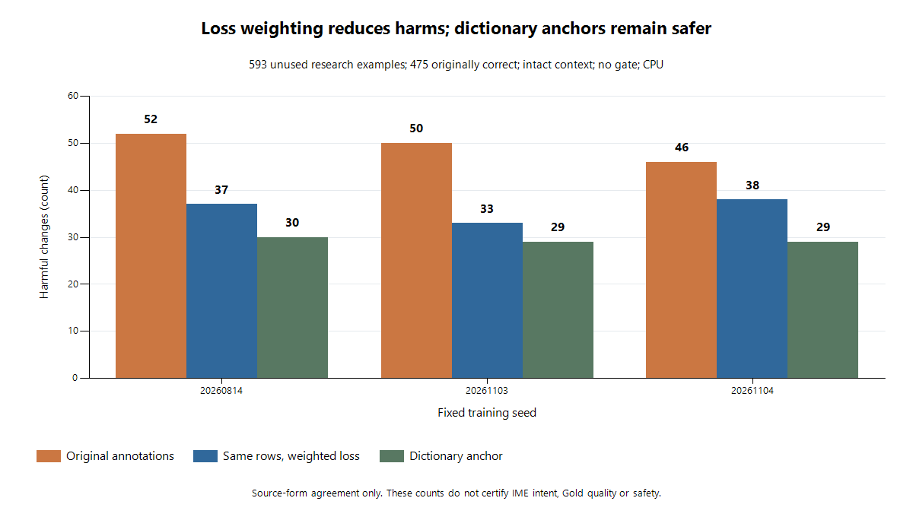

# #33 損失配分の固定比較 — 過剰修正の一部を改善、製品採用はしない

2026-11-06。親 #1、関連 #49 / #34 / #32 / #35。

**原注釈モデルに対する未使用研究集団の平均改善は +1.3491 pp、対応する source-component 95% CI は [+0.1124, +2.5857] pp。** 3 seeds の正解増は +10 / +12 / +2 件、破壊減は 15 / 17 / 8 件で、事前指定した研究前進条件を満たした。ただし、救済も 5 / 5 / 6 件減った。改善は主に過剰な変更の抑制による。

これは**悪化していた原注釈方式からの回復**である。ゲートなし平均は原注釈 77.9651% → 重み付き 79.3142% だが、辞書方式 79.9325% を上回らない。固定ゲート後の平均は原注釈 80.6071% → 重み付き 80.1574% と低下した。今回の母集団は原文表記再現の研究用で、独立 IME Gold、製品精度、採用モデルの 90.72% 更新を意味しない。安全性 **0.25%**、Gate A/B、最終 Test 一回使用の条件は不変。製品採用・既存モデル置換・閾値変更は0。

## 仮説と固定した変更

[前段の train-only 監査](../issue-33-train-change-audit/README.md)では、同じ Wikipedia 25,000 行・同じ各更新の提示順でも、原注釈方式による破壊増が観測された。青空文庫側の baseline 正解率は辞書方式 18,776/25,000、原注釈方式 12,830/25,000。今回変更したのは、原注釈側の正誤別 **損失寄与のみ**。

| 学習部分 | 1例の損失重み | 決定根拠 |
| --- | ---: | --- |
| 共通 Wikipedia 25,000 行 | 1 | 変更なし |
| 原注釈 Aozora・baseline 正解 | 18,776 / 12,830 = 1.46344505 | 元の train の件数のみ |
| 原注釈 Aozora・baseline 誤り | 6,224 / 12,170 = 0.51142153 | 元の train の件数のみ |

全50,000行を維持し、weighted per-example C2 CE の**算術 batch 平均**を使う。batch 内の重み合計では割らない。Aozora の期待総寄与は25,000、全体50,000のまま（float32実測49,999.99988973141）。候補、ラベル、抽出、特徴量、構造、初期 #29 重み、dropout、500 updates、batch256、AdamW、提示順は同じ。全重み1なら旧lossと勾配がbit一致する。

3 new fitsのみ。既存 annotation 3モデルと dictionary 3モデルを再学習せず再利用し、初期 #29 と合わせて10モデルを比較した。全重みを採点前に封印。fit中の評価配列読込・禁止read試行・KWDLC学習混入は0。元の未認証cacheをGoldや一般的な学習適格データへ昇格させていない。

## 未使用資料・候補・評価分母

KWDLC commit `c6ae49d29eca4e1134c6676d682adf5ed6a25f5a`、tree `2bb27542cd2b7832f1e6ff1cc60972326a92ced7` の public-train 3,915資料中、過去予約3,300を除いた**残り615資料すべて**を本文取得前に固定。public dev/testは使用しない。取得3,479,197 bytes、元Git blobとSHA-256照合、retry/replacementとも0。利用許諾の範囲は既存の研究feasibility評価のままで、KWDLCの訓練利用・本文再配布は行わない。原著作者の許諾や元URLに関する制約は未解決のまま維持する。

6,551 eligible inputs・1,929原注釈単位を2回同一に復元。旧979,593ノードを含む**988,073ノード全体**のsource/input/history閉包と逆順再計算が一致。211入力を除外し、主評価は固定615枠のうち593保持、19歴史的関係、3対象なし。補充なし。候補・モデルを見る前の選択であり、評価に不都合な例を落としていない。31対比組・124行は副評価、実際の依存を併合した成分は14。主評価の成分は593。これらの件数だけで現実の独立性やIMEラベルを認証しない。

選択union705行、必要な読み511種類。過去の同じconverter identityの162要求を再利用し、新規349要求は全件完了。未実行・候補取得失敗0。11配列・251,685要素を別式で全照合した。

| 主評価593行の原文表記存在 | 件数 | 割合 |
| --- | ---: | ---: |
| Top-1 | 475 | 80.1012% |
| Top-5 | 581 | 97.9764% |
| Top-6 | 584 | 98.4823% |
| Top-10 | 586 | 98.8196% |
| Top-32 | 586 | 98.8196% |

**この固定KWDLC snapshotの未使用 public-train 枠は0。** 次の学習仮説・ゲート比較へこの593件を再利用しない。旧985件など過去評価やpublic dev/testを代替の未使用集団と呼ばない。新しい出典と独立calibrationの確保が次の先行条件になる。

## 主比較と全モデルの結果

主比較は intact / ungated の weighted − annotation、3 seeds の平均差1本。2000回、seed20261106の共通source-component抽出で3 seedsを同時に再標本化した。各seedのCIの平均ではない。**全seed点推定非負、平均CI下限>0、各seedの破壊非増加**の全条件を事前固定した。全条件が成立したため、損失配分の仮説について研究を前進させる。モデル採用の条件ではない。

| Seed | 正解増 | 破壊差 | 平均ではない各seed差 pp | 個別対応95% CI pp |
| --- | ---: | ---: | ---: | --- |
| 20260814 | +10 | −15 | +1.6863 | [+0.1686, +3.0354] |
| 20261103 | +12 | −17 | +2.0236 | [+0.5059, +3.5413] |
| 20261104 | +2 | −8 | +0.3373 | [−0.8432, +1.5177] |

全表の分母は同じ593行、baseline正解475・誤り118。R=修正成功、H=正しい変換の破壊、W=誤りから別の誤りへの変更、F=修正失敗=H+W。Apply/error=(R+W)/118、Precision=R/(R+H+W)、Recall=R/118、Gainはconverter Top-1からのpp差。Accuracyの角括弧は行仮定のWilson 95%区間。全率のWilson区間・component区間・Hのexact区間は[全指標JSON](../../reports/issue-33-loss-balance-v1.json)に収録している。

### ゲートなし・原文脈

| Model / seed | Accuracy % [Wilson 95%] | R | F | H | W | Apply/error % | Precision % | Recall % | Gain pp |
| --- | --- | ---: | ---: | ---: | ---: | ---: | ---: | ---: | ---: |
| reference29 | 79.764 [76.34, 82.80] | 22 | 45 | 24 | 21 | 36.44 | 32.84 | 18.64 | −0.337 |
| dictionary-20260814 | 79.595 [76.17, 82.64] | 27 | 50 | 30 | 20 | 39.83 | 35.06 | 22.88 | −0.506 |
| dictionary-20261103 | 80.101 [76.70, 83.12] | 29 | 45 | 29 | 16 | 38.14 | 39.19 | 24.58 | +0.000 |
| dictionary-20261104 | 80.101 [76.70, 83.12] | 29 | 48 | 29 | 19 | 40.68 | 37.66 | 24.58 | +0.000 |
| annotation-20260814 | 77.234 [73.69, 80.43] | 35 | 92 | 52 | 40 | 63.56 | 27.56 | 29.66 | −2.867 |
| annotation-20261103 | 78.078 [74.57, 81.22] | 38 | 86 | 50 | 36 | 62.71 | 30.65 | 32.20 | −2.024 |
| annotation-20261104 | 78.583 [75.10, 81.70] | 37 | 84 | 46 | 38 | 63.56 | 30.58 | 31.36 | −1.518 |
| weighted-20260814 | 78.921 [75.46, 82.01] | 30 | 65 | 37 | 28 | 49.15 | 31.58 | 25.42 | −1.180 |
| weighted-20261103 | 80.101 [76.70, 83.12] | 33 | 61 | 33 | 28 | 51.69 | 35.11 | 27.97 | +0.000 |
| weighted-20261104 | 78.921 [75.46, 82.01] | 31 | 68 | 38 | 30 | 51.69 | 31.31 | 26.27 | −1.180 |

### 固定 margin>1.7・原文脈

| Model / seed | Accuracy % [Wilson 95%] | R | F | H | W | Apply/error % | Precision % | Recall % | Gain pp |
| --- | --- | ---: | ---: | ---: | ---: | ---: | ---: | ---: | ---: |
| reference29 | 80.101 [76.70, 83.12] | 4 | 6 | 4 | 2 | 5.08 | 40.00 | 3.39 | +0.000 |
| dictionary-20260814 | 80.607 [77.23, 83.59] | 6 | 5 | 3 | 2 | 6.78 | 54.55 | 5.08 | +0.506 |
| dictionary-20261103 | 80.607 [77.23, 83.59] | 6 | 5 | 3 | 2 | 6.78 | 54.55 | 5.08 | +0.506 |
| dictionary-20261104 | 80.607 [77.23, 83.59] | 6 | 5 | 3 | 2 | 6.78 | 54.55 | 5.08 | +0.506 |
| annotation-20260814 | 80.607 [77.23, 83.59] | 17 | 25 | 14 | 11 | 23.73 | 40.48 | 14.41 | +0.506 |
| annotation-20261103 | 80.607 [77.23, 83.59] | 17 | 24 | 14 | 10 | 22.88 | 41.46 | 14.41 | +0.506 |
| annotation-20261104 | 80.607 [77.23, 83.59] | 16 | 23 | 13 | 10 | 22.03 | 41.03 | 13.56 | +0.506 |
| weighted-20260814 | 80.101 [76.70, 83.12] | 12 | 18 | 12 | 6 | 15.25 | 40.00 | 10.17 | +0.000 |
| weighted-20261103 | 80.270 [76.88, 83.27] | 12 | 17 | 11 | 6 | 15.25 | 41.38 | 10.17 | +0.169 |
| weighted-20261104 | 80.101 [76.70, 83.12] | 12 | 18 | 12 | 6 | 15.25 | 40.00 | 10.17 | +0.000 |

weighted のゲートは25/22/26件の破壊を防ぐ一方、18/21/19件の救済を抑止する。ゲート後H=12/11/12、H/475の片側exact95%上限は **4.0611% / 3.8041% / 4.0611%**。0.25%を満たさない。辞書anchorでもH=3、上限1.6242%。この475件では仮に破壊0件でも上限0.6287%であり、安全性を保証する標本数ではない。閾値探索・Risk-Coverageに基づく選択・calibrationへの転用は今回0。

## 根本原因として分かった範囲

1. **学習の損失配分は、過剰修正の一因。** 行・順序・構造を固定した介入で全seedのHが減少した。原注釈を増やすだけでは、現実の「既に正しい1位を保つ」頻度と学習寄与がずれる。原注釈の誤ラベル率や、語彙・入力単位・文学資料の個別因果を測ったことにはならない。
2. **修正しない判断と、修正候補の順位選択は別に改善する必要がある。** 重み付きでもゲート前平均はbaselineに届かず、既存marginのゲート後利益も改善しなかった。#34のOOF適用判断と独立calibrationを、単純な閾値緩和と区別して進める。
3. **候補生成より未救済・破壊が多い。** weighted seed20260814のゲートなし誤り125件は、Top6欠落9、baseline誤りでTop6に原文表記があるが未救済79、破壊37に分かれる。9件のうちTop32にもないのは7件。追加辞書だけで125件を解決できない。
4. **文脈識別の改善とはまだ言えない。** 副評価124行の正解数は、原注釈46/48/48→重み付き48/49/50、辞書52/54/54。事前指定seed20260814では文脈を空にすると主評価正解+3、固定shuffleでも+3。全条件の結果はJSONに保存し、都合のよい条件・seedを選ばない。

元表記一致と意図された日本語変換の正解は依然別である。独立人手IME Goldは0。単一コーパス・条件付き抽出・過去の研究探索から選ばれた仮説という限界がある。今回の平均CIをGold品質・全IME分布・最終リリースの信頼区間に転用しない。

## 次の優先順位・期待効果・検証費用

| 優先 | 対応先 | 次の検証 | 期待効果と費用 |
| --- | --- | --- | --- |
| P0 | #35 / #32 | 別出典の未使用研究評価と独立calibrationを、モデル評価より先に確保・固定 | 枠の再利用による選択バイアスを防ぐ。候補2–3出典の来歴・利用条件を確認し、最初は最大100資料の読み/入力単位pilot、fit0、全履歴照合。取得費用は出典決定後に実測する。Gold認証とは分離。 |
| P1 | #34 | 順位モデルを固定し、変更を適用するかのOOF判断を検証 | Hを抑えつつ救済を残す。改善幅は未知。例として5-fold OOFなら5 fitsと独立calibrationが必要だが、fold/特徴/費用/閾値選択を別planで先に固定する。今回593件は使わない。 |
| P2 | #49 / #33 | 読み・入力単位・文脈対比の品質を確認したデータ比較 | 件数やモデルサイズを先行させず、今回の損失配分を研究controlとして保持する。改善幅未知。新条件は同量・同予算・3 seedsの一変更比較とし、評価語の埋め戻しや係数探索をしない。 |

## 検証・費用・失敗履歴

全676 unit tests成功、error/failure/skip0。新規12件はloss/勾配・算術平均・無効入力・sampler同一性・主比較のH条件などの契約。180指標群、1,260 Wilson区間、180 exact H区間、平均/各seedの対応CIを別算式で再計算。75,000行の重み、各seed 128,000提示の順序、615元blob、全20,000時間標本も照合。旧16+25 artifactのhash不変。[検算JSON](../../reports/issue-33-loss-balance-verification-v1.json)。型checkerは未実行。AST/import参照検査では未使用importを2件検出し、未bindの予約helperの1件は削除。実行済み`prepare_balance_fit.py`の`rows` import 1件は、fit bindingに固定したbyte hashを守るためそのまま記録した。最終化では構文、diff、追跡artifact、process終了と専用tmp削除を記録する。

CPUはWindows/GPU無効/batch1/ORT intra・inter各1thread、warmup200、モデルのみ10,000回ずつ。全705行×3文脈でCPU PyTorchとONNXのwinner差0、allclose atol/rtol1e-5を全条件通過、最大絶対差1.90735e-6。固定seed20260814のannotationはp95/p99 **0.62591/0.673804 ms**、weightedは **0.666/0.693101 ms**、失敗0。worker往復・製品組込み・Gate Bの証明ではない。[CPU JSON](../../reports/issue-33-loss-balance-cpu-v1.json)。

外側wall実測: 取得171.907s、復元5.308s、全閉包/逆順226.240s、native+数値確認43.896s、fit準備27.035s、3 fits55.953s、30 CPU推論17.539s、CPU測定16.186s、最終検算7.752s。初回復元は旧generic module名の衝突、候補準備は旧CLIの依存importとbatch supersetの契約誤認で停止。最初の結果検算はmanifestの`implementation`/`code`名の違いで停止。各失敗log/receiptを保存し、対象資料や指標・採否を変更せず別receiptで修正した。[全工程集計](../../reports/issue-33-loss-balance-execution-v1.json)。

## 再現と保存

`PYTHONPATH=src;.`、既存固定環境 Python3.13.13 / NumPy2.3.5 / Torch2.12.1+cu130 / ONNX1.19.1 / ORT1.23.2。追加package導入0。Source取得は公式固定commitのGit blob照合。現在のSakura Input観測HEADはclean `bcf42d3ad931c6e081ae4b3fbd4d0e6cd9377d88`。本番コード変更0。

| 境界 | 固定commit |
| --- | --- |
| [plan-v1.json](plan-v1.json)、未使用資料予約、train由来重み | `8ea14eed349b375a63b09c744d3bf40c15ee196b` |
| [candidate-binding-v1.json](candidate-binding-v1.json) | `d3ccff2110e35d6df491673a1bac2a8efeed89cb` |
| [fit-binding-v1.json](fit-binding-v1.json) | `93715d2f5726045a8cc18fae16ffd8cb8df0d51f` |
| [evaluation-binding-v1.json](evaluation-binding-v1.json) | `5fcbb79afcf109391f75e6e880228c259d11f4a4` |
| CPU実装 | `8c1cbf77b8e84e1a4f8600e7be79bc9f9c64f87e` |
| 成功した直接検算実装 | `1163011` |

CLI責任は `acquire_sources.py` → `balance_cohort.py` (prepare/isolate) → `balance_candidates.py` (prepare/execute) → `prepare_balance_fit.py` → `train_balance.py` → `evaluate_balance.py` (seal/infer/report) → `benchmark_balance.py` → `verify_balance.py`。各境界で上表commitを指定する。`run_stage.py`が時間上限・子process終端・write-once receiptを所有する。既存の出力先へ再実行して上書きしない。新たにfit/採点する場合は、別の空の再現環境と元の固定入力artifactが必要。新しい仮説を同じ評価集団で選び直すことは禁止。

公開集計の読み取り照合は `python research/issue-33-loss-balance/publish_balance.py --verify-existing`。全計算のread-only再照合は、別Python process内で `verify_balance.save` を既存JSONとの一致検査に差し替え、`verify_balance.verify('5fcbb79afcf109391f75e6e880228c259d11f4a4')` を呼ぶことで新しい採点なしに行える。実装関数自体は最終保存時もwrite-onceを維持する。

再現handleとしてignored `data/generated/issue-33-loss-balance-v1/`（最終掃除前3,786 files・69,617,109 bytes）、`.codex/goal-loop/issue-33-loss-balance/`、未マージbranch `issue-33-loss-balance-v1` を保持する。原文・読み・候補・選択ID・配列・checkpoint・ONNX・logはGitへ追加しない。公開はcode、hash binding、集計JSON、図のみ。元データの上書き0。人手の判断を生成していない。

最終確認で18 Python filesの構文、上記の固定済み例外以外のimport参照、表の全20行と元JSON、図の9値・軸・凡例、公開JSONのbyte一致、Git diff/追跡artifactを確認した。既存のユーザー変更はstageせず、memoryは新しい検証済み規則だけを部分stageした。所有process残存0を掃除前後で確認。専用 `~/tmp/issue33-loss-balance-20261106/` と今回のbytecodeを削除し、13 files・117,648 bytesを回収した。元の固定Python環境や他sessionのartifactは保持する。

## IRV

- **A 実際の範囲**: この実験directory、loss/statisticsの2 test files、既存のsource/native/numeric契約、旧C2/学習reader/sampler、評価指標とCPU exporter。全repoの再設計はしていない。
- **B 範囲拡張**: 同じ比較条件の証明に候補再利用、全履歴隔離、訓練読込境界、数値backendまで必要だった。さらにgeneric module衝突と旧verifierのsuperset/schema契約を確認した。通常の局所Issueの読み量を超えるが、複数の不変条件を接続する実験のためである。
- **C 責任と状態**: `balanced_loss`が変更したloss規則、`balance_fit_contract`が別fit許可と旧readerの消費、各stageが私有artifact、runnerがprocess終端を所有。既存data API・旧bindings・元split・本番コードは不変。旧実験の実行済みbytesを修正する共通化は行っていない。
- **D 次回の読み範囲**: 原因・固定比率・採否・対応Issue・全指標の入口を本reportへ集約した。再度の候補CLI依存調査は不要だが、次の実験は未使用資料0、batch superset、唯一のloss変更、fit/evaluation別許可という契約を理解する必要がある。既存source graph全体の複雑さが解消したとは主張しない。
