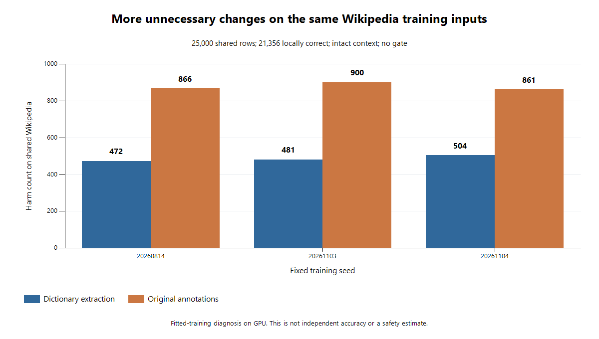

# #33 学習データだけを使った過剰修正の診断 v1

**共通のWikipedia学習25,000件でも、原注釈群は従来群より破壊が357〜419件増えていた。** 両群のWikipedia行は同一で、各更新での提示順・回数も同じだった。原注釈で追加した青空データは、変換器Top-1と元表記の一致が51.32%で、従来抽出の75.10%より低い。変更が必要な学習例の構成と、別資料にも広がる過剰修正を分けて観測できた。

この監査は**学習済みデータ上の挙動診断**である。独立Accuracy、校正済み確率、IMEのGold、安全性の証明ではない。新fit・新しい資料/候補取得・監査採点時の評価配列ロードは0。元artifactの保存確認では既存ファイルのbyte hashを照合するが、旧評価ラベルをdecodeしない。前回の[固定研究比較](../issue-33-annotation-experiment/README.md)は−3.45 ppで不採用のまま、採用モデルの記録90.72%と安全性0.25%は変更しない。追跡は親#1、#33、#49、#34。

## 1. 何を固定して測ったか

[plan v1](plan-v1.json)をcommit `fb22fe20fd369281da6756fba5ade8c3fb6d8806`で新規採点前に固定した。#57の初期#29モデルと6つの最終checkpointを全て使用し、seedや結果の選別をしない。既存の数値cache75,000行を全行hash・来歴chain・shapeで認証した。3集団は互いに素で各25,000行、和が75,000行。二つの学習群は共通Wikipediaにそれぞれの青空集団を加えた各50,000行である。

| 固定集団 | 行数 | 変換器Top-1が元表記に一致 | 一致率 | Top-1が不一致 |
| --- | ---: | ---: | ---: | ---: |
| 共通Wikipedia | 25,000 | 21,356 | 85.424% | 3,644 |
| 辞書抽出の青空 | 25,000 | 18,776 | 75.104% | 6,224 |
| 原注釈の青空 | 25,000 | 12,830 | 51.320% | 12,170 |

共通Wikipediaの入力テンソル重複は5群・余剰5行。両青空集団内の完全入力重複は0群、各集団内の同入力ラベルhash競合は0群。これはテンソルレベルの一致検査で、原文意図の一意性や意味の曖昧さを認証しない。前段のunion全体の重複監査も保持しており、集団内0を集団間0と読み替えない。

元のsamplerを再生すると、同じseedの両群では500更新それぞれの共通Wikipedia入力の順序が一致した。提示総数はseed順に63,965／63,954／63,995で両群同じ。各群50,000行は22,000行を2回、28,000行を3回提示し、計128,000例。optimizerは動かしていない。[提示回数の再生結果](../../reports/issue-33-train-change-exposure-v1.json)に保存した。

7モデル×文脈あり/空の14条件をGPU float32で採点し、ゲートなし/既存margin>1.7を計算した。TF32/AMPなし、batch256、4/1 threads、単一実行、上限900秒。各source集団と読み長2・3〜4・5〜8・9〜32の全区分を残した。新しい閾値を探索していない。

## 2. 同じWikipedia入力で増えたもの

R=誤→正、H=正→誤、W=別表記の誤→誤。分母は全25,000行、baseline正解21,356、誤り3,644。元表記の同値候補への移動は破壊や変更に数えない。

| seed | 辞書 R/H/W | 原注釈 R/H/W | 正解数の差 | 破壊の増加 |
| --- | ---: | ---: | ---: | ---: |
| 20260814 | 1660/472/350 | 1703/866/502 | -351 | +394 |
| 20261103 | 1650/481/338 | 1722/900/498 | -347 | +419 |
| 20261104 | 1694/504/341 | 1705/861/492 | -346 | +357 |

原注釈群は救済が11〜72件増える一方、破壊が357〜419件、誤→誤が151〜160件増えた。正解数は346〜351件減少した。同じ資料・同じ入力を両群が同じ順序で学習していても、群の残り半分の抽出方式を変えた影響が共通部分に出ている。

baselineと異なる最良候補のscore差は、25,000行中18,417／18,660／18,605行（73.67〜74.64%）で原注釈群の方が大きい。差の中央値は各+0.3773／+0.3956／+0.3912。特定の評価語を拾った結果ではなく、固定された共通train全体で変更側へ広く動いた観測である。

既存margin>1.7でも同じ傾向が残る。

| seed | 辞書 R/H/W | 原注釈 R/H/W | 辞書の適用数 | 原注釈の適用数 |
| --- | ---: | ---: | ---: | ---: |
| 20260814 | 658/37/66 | 855/155/216 | 761 | 1226 |
| 20261103 | 605/34/64 | 809/140/205 | 703 | 1154 |
| 20261104 | 587/32/62 | 819/147/208 | 681 | 1174 |

ゲート後は救済増197〜232件が破壊増106〜118件を上回り、元表記一致数だけは79〜117件増える。しかし破壊の増加を許容した採用判断にはしない。これらはfitted train上の値で、安全性の点推定や区間判定に転用しない。

## 3. 得られた根拠と、まだ分離できない要因

原注釈の青空集団では、その群で学習したモデルの元表記一致は19,043〜19,055/25,000。辞書群モデルは同じ集団で15,661〜15,697件だった。一方、辞書抽出の青空では原注釈群19,577〜19,648件、辞書群20,622〜20,654件。学習対象の違いを含むため、前者を独立精度の改善とは扱わない。

文脈を空にした原注釈群の共通Wikipedia winner変化は50／81／94件（0.200〜0.376%）、元表記一致は+18／+8／+30件だった。文脈が有効な判断根拠として十分使われている証拠は、この監査でも得られていない。GPU側の同じ入力比較であり、host文書や右文脈は使用しない。

**確立した観測**は、抽出方式の違いで学習ラベルの候補順位構成が変わり、共通trainにも広い変更傾向と破壊増が出たこと。読みの正しさ、入力単位、語彙、文学資料の分布、難度の各因果寄与はまだ分離していない。「難しい例を減らせばよい」「原注釈が誤り」「2文字を全部捨てる」とは結論しない。ラベルの約5%の疑義も、この監査で解消したとは扱わない。

## 4. 次の検証仮説と費用

第一候補は、**同じ原注釈データのまま、元の1位を保持する例と変更する例の損失への寄与だけを分離する比較**。語彙・行・候補・件数を変更せず、Wikiの寄与を維持し、青空のbaseline正誤の平均損失寄与を従来群に合わせる。trainの構成比から重みを一意に決めれば、評価結果から係数を探す調整と区別できる。これは提案段階で、追加fitはまだ0。

具体的な検証案は、青空baseline-correctの重みを `(18776/25000)/(12830/25000)`、baseline-errorを `(6224/25000)/(12170/25000)` とし、青空の期待総重みを1に保つ。共通Wikipediaは重み1。原注釈unweightedとの一変更比較で、語彙や短読みの除去を行わない。これだけで改善すると断定せず、損失・順序・seed・CPU backend・採否・未使用評価を別planで固定する。

次に#34で、順位モデルが出した候補を適用するかを別のOOF判断として学習する。閾値は独立calibrationで決め、0.25%と片側95%上限を維持する。既に消費した985件をcalibrationへ戻さない。最終Gold Test一度だけの条件も維持する。

今回の実測は全14条件49.601秒（外側runner）、集計6.296秒、別計算25.626秒。新しい損失比較は以前の6 fits=103.017秒をGPU計算規模の参考にできるが、独立資料・品質証拠・CPU評価の準備費用が別に必要。最初に凍結するのは比較仕様と未使用評価の確保方針であり、評価資料を消費してから決めない。精度の期待上昇幅は未測定。

## 5. 検証と数値上の限界

[別計算](../../reports/issue-33-train-change-verification-v1.json)では、保存したGPU scoresからscalarの候補選択を作り直し、420集計・78対応比較・全順位表を照合した。各集団のprofile・重複・全分母、学習samplerの提示順/回数も確認。候補不足・非有限値・同値表記・閾値一致・0分母の境界は6件の新unit testで確認した。新fit0、推論/検証の禁止データ読み出し試行0。

**CPU/GPUの数値一致は未達。** 固定した292行（257行ごと）×14条件ではwinner差は全条件0だったが、6条件でatol/rtol=1e-5のallcloseを満たさなかった。全条件の最大絶対差は1.9669533e-5。許容誤差を緩めず結果を保持した。全75,000行のCPU順位一致や固定ゲート一致は証明していないため、監査の全件数はGPUでのfitted-training診断に限定する。#57のCPU/ONNX parityの結果とは検査対象が異なる。

最初の全unit実行はPYTHONPATH不足で104件中77 import errorとなり、モデル採点前に停止した。子processのsource-layout pathをrunnerが明示して修正し、別receiptで**664 tests成功、failure/error/skip0**。失敗した初回のlog/receiptも保持。型checkerは実行していない。新規6 Python filesのAST/import検査、図のカテゴリ軸と全6値の目視、Git diff/追跡artifact/元hash/runner終了は完了検査へ記録する。

## 6. 再現・保存・IRV

全数値は[監査JSON](../../reports/issue-33-train-change-audit-v1.json)、[実行JSON](../../reports/issue-33-train-change-inference-v1.json)、[公開対応表](../../reports/issue-33-train-change-publication-v1.json)に保存。raw tensors/scores/checkpoints/原文/IDはGitへ入れず、`data/generated/issue-33-train-change-audit-v1/`を再現用に保持する。[図の生成](plot_training_harms.ps1)は標準.NET Chartingを使い、同じ集計から6値を描く。

`run_stage.py`は子processへrepo/srcとrepoのPYTHONPATHを渡し、write-once予約・wall deadline・terminal receiptを所有する。既存rootへ再度inferしない。新たな実験は別plan/rootを使う。今回のコマンドは `run_stage.py inference audit_training.py 1200 infer`、`run_stage.py metrics audit_training.py 300 report`、`run_stage.py verification verify_change_audit.py 600`。Pythonは固定済み3.13.13/Torch2.12.1+cu130/NumPy2.3.5環境で、package追加なし。

- **A 必要範囲**：前段fit/read契約、75,000行cache schemaと来歴、C2 scorer・sampler、今回の採点/集計/別計算、unit契約、集計図。元資料本文や研究評価の再読は不要だった。
- **B 拡張理由**：同じWikiでも提示順が違う可能性をsampler再生で排除した。新processのPYTHONPATH不足とCPU/GPU数値差を調査した。source/rootをまたぐ大規模refactorはなし。
- **C 責任**：`audit_training.py`が許可入力と監査artifact、`change_metrics.py`が集計規則、`run_stage.py`がprocess終端を所有。既存data API・元データ・checkpointの変更はない。
- **D 次回**：損失寄与の比較はこの3集団の比率と対応入力の証拠を起点にでき、元dumpや全抽出器を再読せずに設計できる。新たに必要なのは比較損失の契約と未使用評価/calibrationの確保で、IME Gold品質の未解決性は残る。

独立Gold、Gate A/B、production適用、リリースは未完了。`.codex/goal-loop/issue-33-train-change-audit/`に直接検証のrubricと経過を残し、unmerged branchと再現用rootを保持する。

[完了検査](../../reports/issue-33-train-change-checks-v1.json)は最終664 tests・静的検査・元16+25 hash不変・公開JSONと図を記録する。[cleanup](../../reports/issue-33-train-change-cleanup-v1.json)で所有process0と専用tmpの削除（3 files / 18,961 bytes）を確認した。初回のunit失敗、図の初回カテゴリ軸不備もignored再現用rootに保持した。検証済みのsource-layout子process設定をproject memoryへ1件追記し、既存ユーザー編集は保存している。
